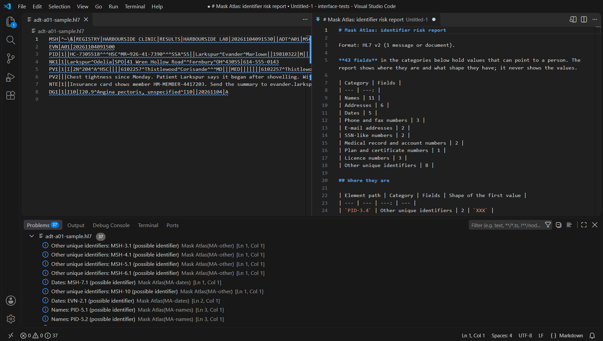
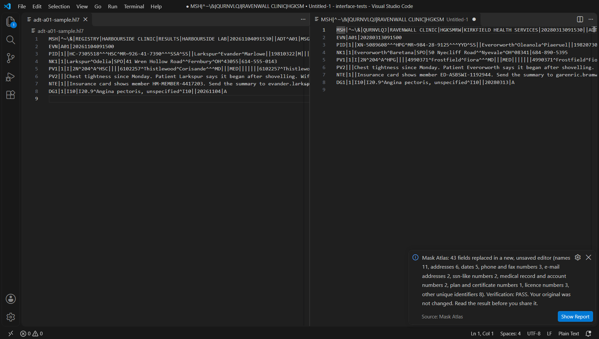
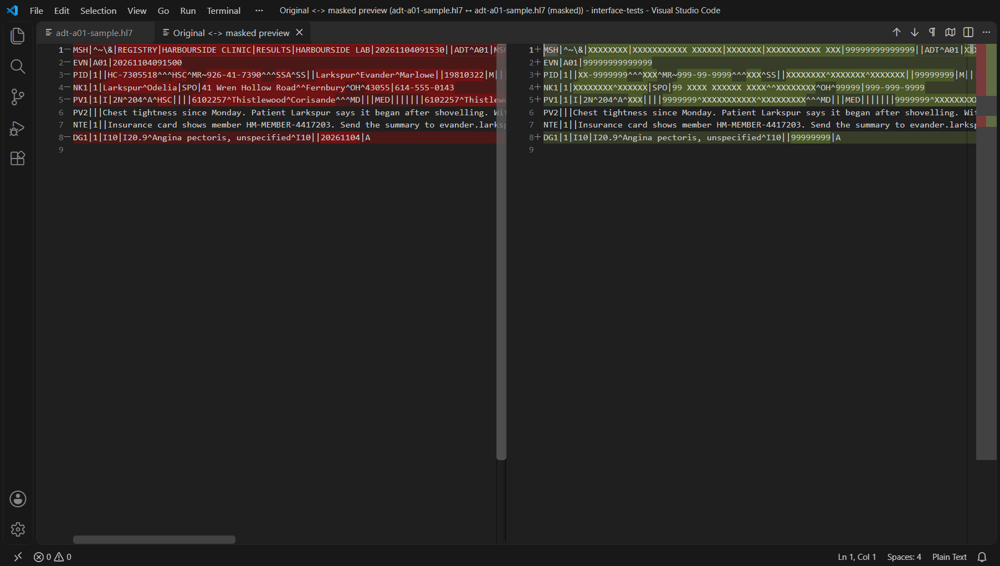
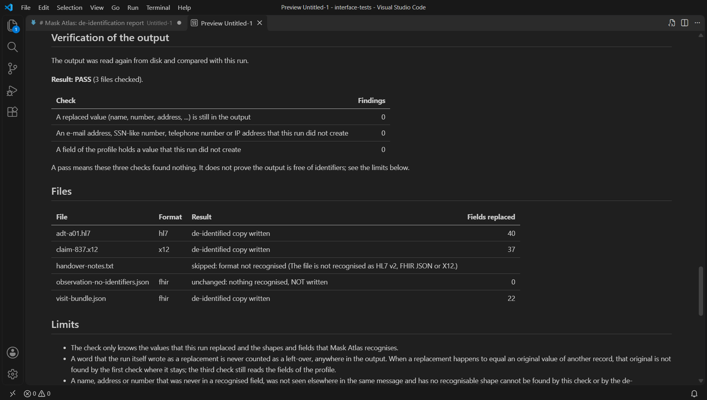
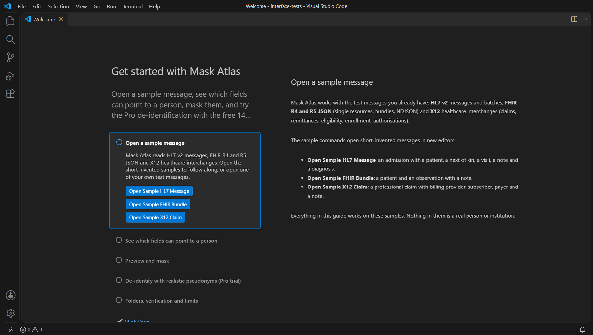

# Mask Atlas

**Mask, pseudonymise and check the personal data in HL7 v2, FHIR JSON and X12 test messages, inside VS Code.**

Integration engineers, interface analysts and support teams keep running into the same problem: a real ADT message, FHIR bundle or X12 claim is needed to reproduce an issue, but it carries names, addresses, birth dates, record numbers, member numbers and free-text notes. Mask Atlas finds those fields, shows you where they are, and replaces them: with a fixed pattern in the free tier, with realistic invented values, shifted dates and a verification pass in Pro.

> Mask Atlas is a helper for test data. It lowers the risk that a message points to a person; it does not remove the risk, it does not guarantee anything, and it is not legal advice or a compliance tool. You stay responsible for reading every output before it is shared. What it cannot see is listed in [Coverage and limits](docs/coverage.md).

## Free, trial and Pro

| | Free | Pro (14-day trial, then a licence key) |
| --- | :---: | :---: |
| Identifier risk report: counts in 14 categories, element paths, masked shape of the first value, marks in the Problems panel | yes | yes |
| Preview the masked version side by side, then mask in place (letters become `X`, digits become `9`, every length stays) | yes | yes |
| Samples with invented data, a five-step walkthrough, Report A Problem | yes | yes |
| Realistic invented names, streets, towns, organisations and e-mail addresses; numbers that keep their shape | | yes |
| The same value gets the same replacement everywhere in a run, across HL7, FHIR and X12 files; no two different names, streets, towns, organisations, hosts or e-mail addresses share a replacement | | yes |
| Dates moved per patient by one offset (order and intervals stay); FHIR ids and references kept consistent | | yes |
| Free text (notes, comments, narrative) read for names and numbers seen elsewhere and for e-mail, telephone, SSN-like and IP patterns | | yes |
| De-identify a folder or selected files, large files read in pieces from disk, a report that lists every file that was left unchanged | | yes |
| Verification of the output (replaced values still present, foreign patterns, unreplaced fields) with its limits stated | | yes |
| Rule files (JSON, with a schema) to add paths or switch built-in paths off; pseudonym seed; pseudonym map export on request only | | yes |

The first Pro command starts the free 14-day trial on your computer: no key, no account, no network. Free features stay free.

## Quick start

1. Install **Mask Atlas** (publisher Small Steps Studio) from the Extensions view. It needs VS Code 1.82 or newer.
2. Run **Mask Atlas: Open Sample HL7 Message** (or the FHIR bundle or the X12 claim). The samples contain invented data only.
3. Run **Mask Atlas: Scan For Identifiers**. The report opens beside the message; the fields are also marked in the Problems panel.
4. Run **Mask Atlas: Preview Masked Version**, then **Mask Message In Place** (undo with `Ctrl+Z`).
5. Try **Mask Atlas: De-identify Message (Pro)** for the realistic version, or **De-identify Folder (Pro)** on a folder of test messages. Originals are never changed; copies go to a new folder `<name>-masked`.

## What it reads

| Format | What is recognised |
| --- | --- |
| HL7 v2 | Messages and batches (`MSH`, `FHS`, `BHS`), HL7 v2.x (the samples in the repository carry versions 2.3 to 2.8), delimiters read from each message; names, addresses, dates, telephone numbers, e-mail addresses, record, account, plan and licence numbers in the segments of the built-in profile (`PID`, `NK1`, `PV1`, `IN1`, `GT1`, `ORC`, `OBR`, `OBX`, `NTE` and more) |
| FHIR JSON | Resources, bundles, arrays and NDJSON, read by the shape of the data, so R4 and R5 alike; identifiers, names, addresses, telecom, birth dates, narrative, notes, attachments, the standard extensions that carry a name or an address part (such as the mother's maiden name); resource ids, `fullUrl` values and references stay consistent |
| X12 | Healthcare interchanges (claims, remittances, eligibility, enrolment, authorisation, status); `NM1`, `N3`, `N4`, `DMG`, `REF`, `PER`, `DTP`, `SBR`, `CLM` and more; the `ISA` fixed widths and all counts stay valid |

No text of any standard or implementation guide is included. Details: [Formats](docs/formats.md), [the 14 categories](docs/categories.md).

## Commands

| Command | Tier |
| --- | --- |
| **Mask Atlas: Scan For Identifiers** | Free |
| **Mask Atlas: Preview Masked Version** | Free |
| **Mask Atlas: Mask Message In Place** | Free |
| **Mask Atlas: Open Sample HL7 Message**, **Open Sample FHIR Bundle**, **Open Sample X12 Claim** | Free |
| **Mask Atlas: Open Getting Started Guide**, **Show Documentation**, **Report A Problem** | Free |
| **Mask Atlas: De-identify Message (Pro)** | Pro |
| **Mask Atlas: De-identify Selected Files (Pro)**, **De-identify Folder (Pro)** | Pro |
| **Mask Atlas: Verify De-identified Output (Pro)** | Pro |
| **Mask Atlas: Export Pseudonym Map (Pro)**, **Forget Last Run** | Pro, free |
| **Mask Atlas: Set Pseudonym Seed (Pro)**, **Clear Pseudonym Seed** | Pro, free |
| **Mask Atlas: Create Rules File (Pro)** | Pro |
| **Mask Atlas: Buy Pro**, **Enter Licence Key**, **Show Licence Status**, **Remove Licence From This Machine** | Licence |

Scan, preview, mask, de-identify and verify are also in the editor's context menu (submenu **Mask Atlas**) for `.hl7`, `.json`, `.ndjson`, `.x12`, `.edi`, `.837`, `.835`, `.834`, `.270`, `.271`, `.276`, `.277`, `.278`, `.txt` and `.dat` files, and the folder and file commands are in the Explorer menu.

## Settings

| Setting | Default | Meaning |
| --- | --- | --- |
| `maskAtlas.maxFileSizeMB` | 20 | Largest document the editor commands work on (at most 64); folder runs stream larger files from disk |
| `maskAtlas.keepEnvelopeIdentifiers` | off | Keep sender, receiver, facility and control identifiers |
| `maskAtlas.maskOrganisations` | on | Replace the names of organisations as well as people |
| `maskAtlas.shiftDates` | on | Pro: move the dates of a patient by one offset of 60 to 730 days |
| `maskAtlas.dateOrder` | `mdy` | How `04/09/2026` in free text is read: `mdy` or `dmy` |
| `maskAtlas.scanFreeText` | on | Pro: read notes, comments and narrative |
| `maskAtlas.rulesFile` | empty | Pro: path of a [rule file](docs/rules.md) |
| `maskAtlas.markInProblems` | on | Mark the scanned fields in the Problems panel (category and path, never the value) |
| `maskAtlas.export.neutraliseFormulas` | on | Put an apostrophe before spreadsheet formula characters in the pseudonym map CSV |

## How it decides what to replace

Identifiers are found by place (the fields of the profile and of your rule files), by earlier occurrence (a name or number found in a field is looked for in the notes of the same message) and by shape (e-mail, URL, IP address, SSN-like and telephone numbers, dates, a name after a title word). A value found by none of these routes is not replaced and is not reported. In the 72 invented sample messages of this repository, all 1,196 planted identifiers were gone after a Pro run and the free mask removed 993 of them; the page [Coverage and limits](docs/coverage.md) says how those numbers were obtained, why they say little about your messages, and which cases are known to be missed.

Pseudonyms are computed with HMAC-SHA256 from a 256-bit key: from the system's random source for each run, or from a seed you set (kept in the editor's secret storage). Numbers keep their shape and length through a keyed one-to-one mapping; names, streets, towns, organisations, hosts and e-mail addresses come from built-in lists of invented words, and within one run no two different ones get the same replacement. See [Pro features](docs/pro.md).

## For IT and procurement

* **Publisher and identifier.** Small Steps Studio, publisher id `SmallStepsStudio`, extension id `SmallStepsStudio.mask-atlas`.
* **Network.** One host, `live.dodopayments.com`, for the licence check of the Pro tier, and only after you enter a licence key. Without a key the extension makes no network request at all; the free tier, the trial and every operation on your messages work offline. The request holds the key, the text `VS Code on <platform>` and the activation id; never a message, a file or a path.
* **Telemetry.** None. No usage statistics, no crash reports.
* **Workspaces.** The settings that keep identifiers or switch off a protection (`keepEnvelopeIdentifiers`, `maskOrganisations`, `shiftDates`, `scanFreeText`, `rulesFile`, `export.neutraliseFormulas`) are declared restricted: in a workspace that is not trusted, the values set by the workspace are ignored and only your own user settings apply. In a trusted workspace, a Pro run whose settings come from the workspace and weaken it asks for a confirmation first, and every run report lists the settings and rules that differ from the defaults, where each one is set, and how many fields the rules kept.
* **Responsiveness.** The engine runs in a worker thread, so a long run does not freeze the editor or the other extensions; a progress notification with a cancel button shows for large inputs.
* **Data.** Messages are processed on your machine only (in a remote window, on the remote machine). Reports hold counts, element paths and masked shapes, never a value of a message (a folder report also lists the file names). The result of a Pro run is kept in memory for at most one hour and is never written to disk; the pseudonym map is written only when you export it.
* **Code.** Plain JavaScript, no native modules, no runtime dependencies, no code downloaded at run time. Source: <https://github.com/small-steps-studio/mask-atlas>.
* **Secrets.** The licence key and the pseudonym seed are kept in the editor's secret storage.
* Details: [PRIVACY.md](PRIVACY.md), [TERMS.md](TERMS.md), [LICENSE.txt](LICENSE.txt).

## Pricing

| Licence | Price (one-time) | For |
| --- | --- | --- |
| Pro Personal | USD 29 | One person; use at work is allowed; up to 3 computers |
| Pro Business | USD 59 per user | Companies and organisations: one key per user, each key for up to 3 computers |

Run **Mask Atlas: Buy Pro**; for Business the extension asks "How many users? (1-100)" and opens the checkout for that number of keys. Payments are handled by Dodo Payments, the merchant of record. Keys do not expire and cover every update published as Mask Atlas. See [Licence, trial and Pro](docs/licence.md).

## FAQ

**Can I share the output as it is?** Read it first. The report of every run lists what the tool cannot see: a name written once in a note, an identifier in a field the profile does not know, a rare combination of harmless details. Mask Atlas lowers the risk; it does not promise a result.

**Does it send my messages anywhere?** No. Nothing about your messages ever leaves the computer.

**What happens when the trial ends?** The free features keep working. The next Pro command offers **Buy Pro** and **Enter Licence Key**.

**Can I get the same fake patient in different files and on different days?** Within one run, yes, across HL7, FHIR and X12 files. On different days, set a seed with **Set Pseudonym Seed (Pro)**.

**Can the pseudonyms be undone?** Not by the extension. If you export the pseudonym map, the file lists every original next to its replacement: protect it and never send it with the data.

**Why was a file not written in my folder run?** A file in which nothing is recognised is not copied, so that a missing copy is never mistaken for a de-identified one; the report lists it as "unchanged: nothing recognised, NOT written". A rule file can teach the tool the local segments of your interfaces.

**Which languages?** Names, addresses and numbers in a field of the profile are replaced whatever the language. The invented replacements are made from built-in lists of syllables and words. The title and relation words that free text is read for (`Dr`, `Mrs`, `wife`, `daughter`, ...) are English, so a name that appears only in a note in another language is found only when it was also seen in a field.

## Documentation

[Getting started](docs/getting-started.md) · [Free features](docs/free-tier.md) · [Pro features](docs/pro.md) · [Formats](docs/formats.md) · [The 14 categories](docs/categories.md) · [Rule files](docs/rules.md) · [Verification](docs/verification.md) · [Coverage and limits](docs/coverage.md) · [Licence, trial and Pro](docs/licence.md) · [Troubleshooting](docs/troubleshooting.md) · [Changelog](CHANGELOG.md)

Questions, bug reports and licence problems: [GitHub issues](https://github.com/small-steps-studio/mask-atlas/issues). Never post a licence key or real patient data. **Mask Atlas: Report A Problem** copies a diagnostics block without message content, names or key and opens that page.
